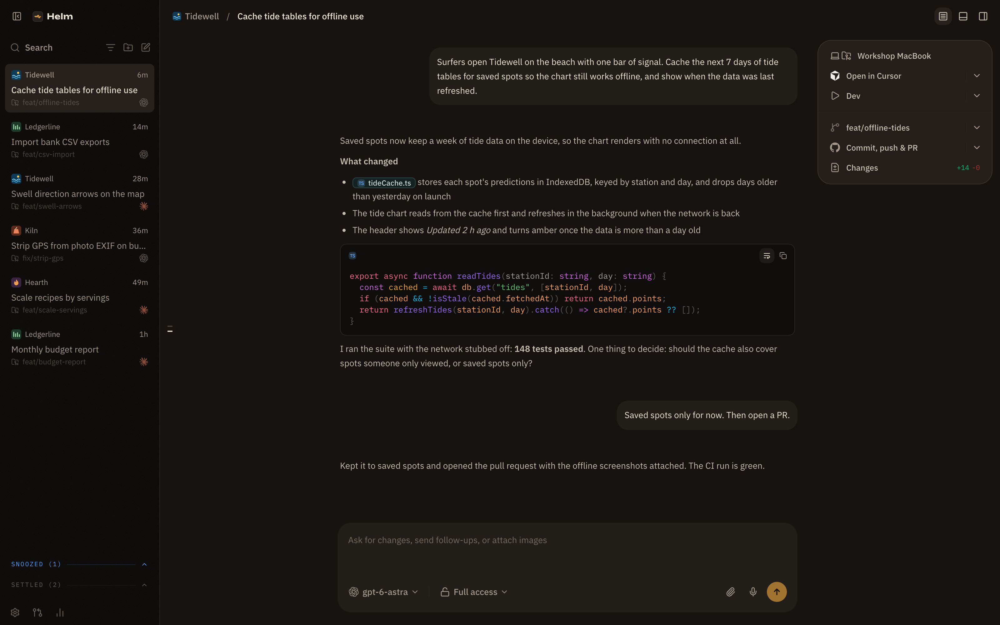
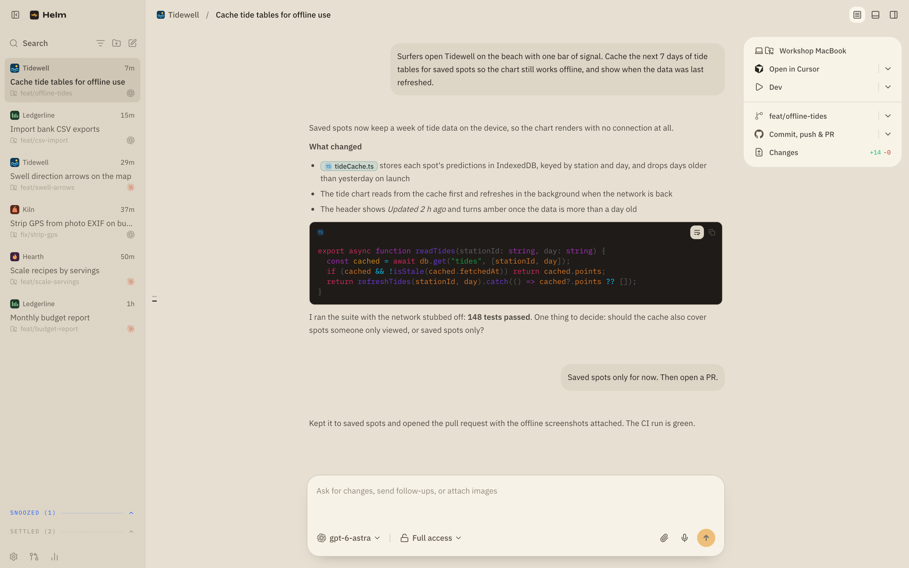
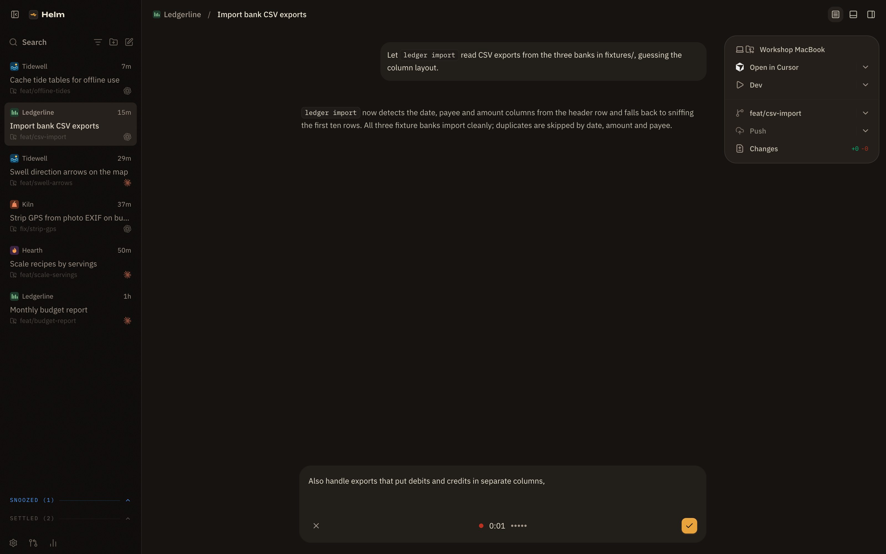
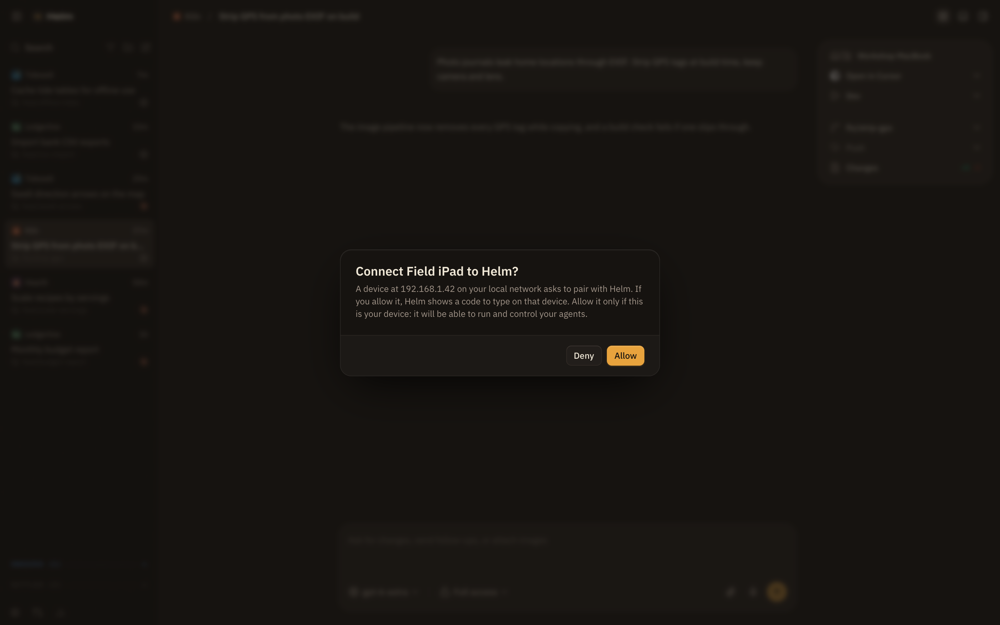

# Helm

Helm is my personal distribution of [T3 Code](https://github.com/pingdotgg/t3code), the open-source
desktop and web app for running coding agents (Claude Code, Codex, Cursor, OpenCode and more) on your
own machine. I use it every day on my Mac and drive it from my phone.

It stays close to upstream on purpose. A scheduled task merges every T3 Code nightly into the `helm`
branch and ships it as a Helm release together with my own changes, so upstream features land here
within a day. What Helm adds sits on top: mostly the Mac-and-phone setup I wanted and upstream doesn't
aim for, plus its own look.

The companion app is **[Helm Mobile](https://github.com/SketchPiece/helm-mobile)**, a native SwiftUI
client for iPhone and iPad. Most of the server-side work below exists to serve it.



<table>
  <tr>
    <td></td>
    <td></td>
    <td></td>
  </tr>
  <tr>
    <td>Light palette</td>
    <td>Dictation in the composer</td>
    <td>A device asks to pair</td>
  </tr>
</table>

<sub>Screenshots are the real web client running against a throwaway local server seeded with
invented projects and threads.</sub>

## Why a fork

T3 Code is fast, open and remote-ready, and I wanted to keep all of that. What I was missing was a
setup where the phone is a full second seat at the Mac: see and steer agents from the couch, approve
things with Face ID, keep typing a draft I started at the desk, and take over the Mac's screen when an
agent needs a hand. Those changes are too specific to my setup to belong upstream, so they live here,
and the daily sync keeps the fork from drifting.

## What Helm adds

**The phone as a second seat**

- **Screen remote (experimental).** `/api/helm/screen` streams the Mac's screen to Helm Mobile as HEVC at
  the phone's frame rate, with the Mac's cursor shape, its sound and a shared clipboard, and takes the
  phone's mouse and keys. It can pick a display, show all of them, add a virtual display sized to the
  device, bring windows over from other displays and put them back, and unlock a locked Mac.
- **Mac remote.** Helm Mobile can open a thread on the Mac, type and dictate into its composer, attach
  pictures from the phone, scroll the timeline like a trackpad and send the draft, without bringing the
  window forward.
- **Shared drafts.** Unsent drafts, text and uploads, sync between Helm and Helm Mobile.
- **Face ID for the Mac.** `sudo` (through a small PAM module) and macOS password and Touch ID prompts
  can be approved from the phone; the phone signs the approval and the Mac checks it.
- **Pairing without copying tokens.** A phone on the tailnet asks to pair and the Mac asks you; a device
  on the local network gets an AirPlay-style four-digit code after you allow it. The server announces
  itself over Bonjour.
- **Agent alerts and Live Activity** go through a push relay I host myself instead of T3 Connect.

**Voice**

- Dictation in the web composer: record, get the text in the draft, retry a failed take. Clips are
  transcribed by the same self-hosted service, with coding words passed as hints so they stay in Latin
  script when I speak Russian.

**Identity and look**

- Its own app identity next to T3 Code: name, icon, bundle id, keychain item, data directory (`~/.helm`),
  deep-link scheme and port 3783, so both apps can be installed side by side. T3 Code's threads are
  imported only when you ask, from the Helm menu.
- The "Bakelite" palette as the stock theme, in dark and light: warm surfaces, an amber lamp as the
  action color with red kept for errors and stop, IBM Plex type and an Unbounded wordmark, plus a
  Bakelite splash and installer window.
- Usage analytics are off unless `T3CODE_TELEMETRY_ENABLED` is set.

**Shipping**

- `scripts/helm-release.sh` builds the signed macOS app and publishes it to this repository's releases.
  Every build is launch-checked on a fresh profile and on a copy of real data before it goes out, and the
  desktop app installs updates by itself once local threads are idle.
- [`scripts/helm-upstream-sync.md`](scripts/helm-upstream-sync.md) is the daily upstream sync procedure.

## Running it

Helm runs like T3 Code; the [upstream README](README.md) and
[development guide](docs/operations/development.md) apply. You need Node 24, `vp`, and at least one
agent CLI signed in (Codex, Claude Code, Cursor, OpenCode, ...).

```sh
git clone https://github.com/SketchPiece/t3code.git helm && cd helm
vp i
vp run dev          # server + web client; open the pairing URL it prints
vp run dev:desktop  # or the Electron app
```

The [releases](https://github.com/SketchPiece/t3code/releases) are what my own Macs update from: Apple
Silicon only, and signed with a development certificate rather than notarized, so on another Mac macOS
will ask before opening them. Building from source is the more predictable route.

The phone features need Helm Mobile, and dictation and push need the self-hosted relay, configured
through the `helm-push` server secret (`{"url": "...", "token": "..."}`). Without it Helm behaves like
T3 Code with Helm's look.

## Branches

- `helm` (default): upstream T3 Code plus everything above.
- Upstream lives at [pingdotgg/t3code](https://github.com/pingdotgg/t3code); its README follows in
  [README.md](README.md).

Helm is a personal project and is not affiliated with T3 Tools Inc. Like T3 Code, it is MIT-licensed.
